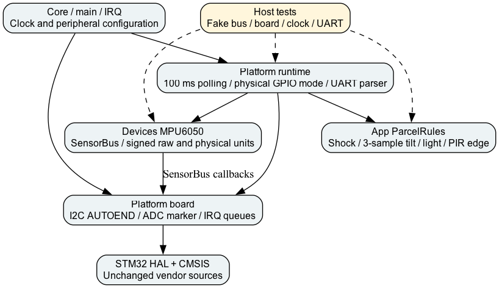

# ParcelLog: структура ЛР2

Core зберігає clock, AF та IRQ. Platform/board.c містить I2C1 AUTOEND, timeout10 ms, ADC і IRQ UART queues. Platform/runtime.c планує 100-ms збір, фізичні GPIO modes, UART commands та retries. Devices/mpu6050.c використовує SensorBus callbacks; зберігає raw і фізичні одиниці. App/parcel_rules.c зберігає початкові пороги й не включає HAL. tools/check_project.py перевіряє ці залежності.

IMU retry2 s; ADC retry1 s. Немає HAL_Delay в loop, проте I2C та ADC синхронні з обмеженим часом. UART RX256/TX2048, parser63 chars,128 chars per poll. PB0 визначає transit/storage, PB1 є PIR. LED heartbeat500 ms. Журнал живе до reset.

Тести драйвера, правил та runtime запускаються make test. make test-linux додає ASan/UBSan. make coverage рахує тільки App+Devices, runtime перевіряється fake-тестом окремо, Board/HAL відсоток не охоплює.
