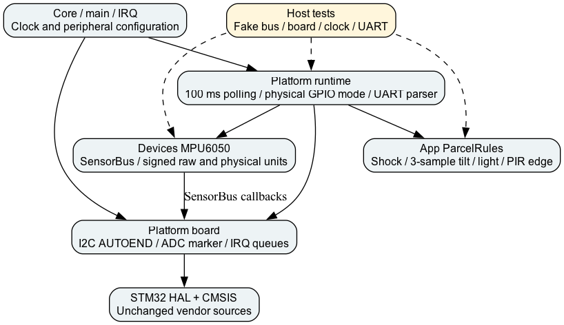

# ParcelLog: структура ЛР2

Core зберігає clock, AF та IRQ. Platform/sensor_transport.c містить I2C1 AUTOEND і загальний timeout 10 мс, board.c — GPIO та IRQ UART, parcel_light.c — ADC, а tx_queue.c керує чергою передачі. Platform/runtime.c планує 100-ms збір, фізичні GPIO modes, UART commands та retries. Devices/mpu6050.c використовує SensorBus callbacks; зберігає raw і фізичні одиниці. App/parcel_rules.c зберігає початкові пороги й не включає HAL. tools/check_project.py перевіряє ці залежності.

IMU retry 2 s; ADC retry 1 s. Немає HAL_Delay в loop, проте I2C та ADC синхронні з обмеженим часом. UART RX256/TX2048, parser63 chars,128 chars per poll. PB0 визначає transit/storage, PB1 є PIR. LED heartbeat 500 ms. Журнал використовує внутрішню flash; збереження після reset і стирання в Wokwi потребують окремої перевірки.

Тести драйвера, правил та runtime запускаються make test. make test-linux додає ASan/UBSan. Інструкції до вимірювання покриття вибраних модулів наведено в tools/HEADLESS-TOOLS.md; Board/HAL таким вимірюванням не охоплені.

## ЛР3

App/shipment_log кодує власний 32-байтовий запис посилки та виконує CRC recovery через storage callbacks. App/run_meter задає фіксовані release і статистики. Platform/flash_store використовує HAL для останніх двох сторінок внутрішньої flash, а instrument налаштовує джерело часу та службові GPIO. Для дослідженої збірки обрано SysTick із кроком 1 мс. Runtime не перемикає контекст і не має RTOS. Діаграма: metrics/lab3/superloop.png.

UART RX має 256 timestamp разом із byte ring, TX лишається 2048 bytes. Перед log/stats перевіряється TX free, один рядок за poll. Flash write/erase є синхронними; наступний poll їх не перериває. .RamFunc HAL входить до .data і копіюється startup у RAM. Це виправляє розміщення HAL helper, але не переносить весь HAL wait/IRQ/vector table у RAM.

Код обмежено 28 KiB, 4 KiB відведено журналу. Резерв stack 2 KiB, мінімальний heap 512 bytes. Фактичні витрати стеку/heap ще не виміряні. Сценарії та межі: tasks.md, limitations.md, baseline-lab4.md.

Діагностична збірка раніше використовувала TIM3 і GDB; їхні результати не переносяться на збірку з SysTick. Стан flash зберігається в shipment_flash_diag для фактичного читання GDB; обидві сторінки читає lab3_rsp_probe.py.
